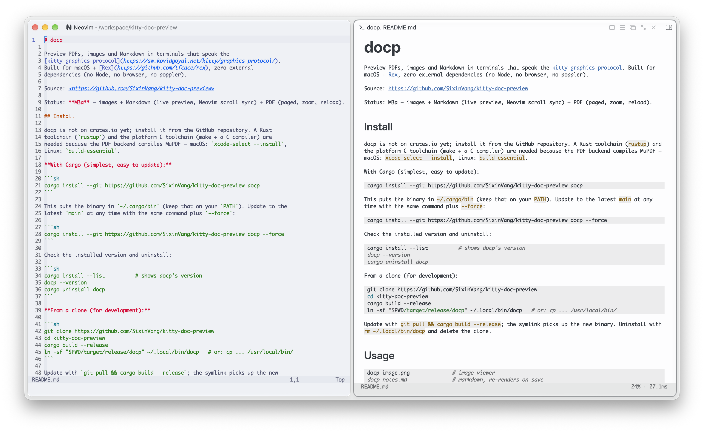

# docp

Preview PDFs, images and Markdown in terminals that speak the
[kitty graphics protocol](https://sw.kovidgoyal.net/kitty/graphics-protocol/).
Built for macOS + [Rex](https://github.com/tfcace/rex), zero external
dependencies (no Node, no browser, no poppler).

Source: <https://github.com/SixinVang/kitty-doc-preview>

Status: **M3a** — images + Markdown (live preview, Neovim scroll sync) + PDF (paged, zoom, reload).



## Install

docp is not on crates.io yet; install it from the GitHub repository. A Rust
toolchain (`rustup`) and the platform C toolchain (make + a C compiler) are
needed because the PDF backend compiles MuPDF — macOS: `xcode-select --install`,
Linux: `build-essential`.

**With Cargo (simplest, easy to update):**

```sh
cargo install --git https://github.com/SixinVang/kitty-doc-preview docp
```

This puts the binary in `~/.cargo/bin` (keep that on your `PATH`). Update to the
latest `main` at any time with the same command plus `--force`:

```sh
cargo install --git https://github.com/SixinVang/kitty-doc-preview docp --force
```

Check the installed version and uninstall:

```sh
cargo install --list          # shows docp's version
docp --version
cargo uninstall docp
```

**From a clone (for development):**

```sh
git clone https://github.com/SixinVang/kitty-doc-preview
cd kitty-doc-preview
cargo build --release
ln -sf "$PWD/target/release/docp" ~/.local/bin/docp   # or: cp ... /usr/local/bin/
```

Update with `git pull && cargo build --release`; the symlink picks up the new
binary. Uninstall with `rm ~/.local/bin/docp` and delete the clone.

## Usage

```sh
docp image.png              # image viewer
docp notes.md               # markdown, re-renders on save
docp paper.pdf              # PDF, fit-width, n/p pages, z/Z zoom
docp --page 12 paper.pdf    # start on page 12
docp --theme light notes.md # terminal (default) | dark | light
docp --cat notes.md         # plain styled output, no alt screen
docp --info                 # print detected capabilities and config
docp --ipc /tmp/p.sock n.md # also serve editor scroll sync (Neovim plugin)
```

Fonts and layout are configurable, by file or by flag (flags win):

```sh
docp --font-sans "Atkinson Hyperlegible" notes.md
docp --font-sans-file ~/Library/Fonts/MySans.ttf notes.md
docp --max-width 90 notes.md
docp --config ./docp.toml notes.md
```

```toml
# ~/.config/docp/config.toml   (see docp.example.toml)
[theme]
name = "terminal"            # terminal | dark | light

[fonts]
sans = "PingFang SC"         # headings / pixel text (system family is fine)
mono = "JetBrains Mono"      # diagram labels
sans_file = ""               # optional files win over the families
mono_file = ""

[layout]
max_width = 110              # text column clamp, in cells
```

Keys: `j/k` scroll · `space/b` page · `d/u` half page · `g/G` top/bottom
(`G` also follows the file) · `]`/`[` next/previous heading · `r` redraw ·
`q` quit · mouse wheel, drag to select (release copies), `y` copy again,
`Esc` clear selection.

PDF adds: `n/p` (or `]`/`[`) next/previous page · `1`–`9` jump to 10 %…90 % ·
`z`/`Z` zoom in/out (re-rasterised, never upscaled) · `h/l` pan when zoomed ·
`Option+J/K` instant 5-row jumps (the old non-animated feel) · `r` reopen.
Scroll with `j/k`/wheel is pixel-smooth. Page number sits in the left gutter
and in the status bar.

## What it does

- **Hybrid Markdown rendering.** Body text, lists, quotes, tables, links and
  highlighted code stay real terminal text — searchable, copyable, tmux-safe.
  Only what a cell grid cannot express becomes pixels: H1/H2 display headings,
  Mermaid diagrams, and embedded images.
- **YAML frontmatter.** A `---` block at the top of a Markdown file renders as
  a compact properties card instead of leaking into the body: nested keys are
  flattened to `author.name`, lists join into one line, block scalars wrap
  under the key column, and malformed YAML falls back to a highlighted block.
- **Mouse selection with copy.** Drag over the terminal text to select it; the
  highlight follows the document when you scroll, releasing the mouse copies
  through OSC 52 (plus a local `pbcopy`/`wl-copy`/`xclip` helper), and `y`
  copies the current selection again.
- **Pixels are sent once.** Images ride in the text grid as Unicode
  placeholders, so scrolling, redraws and resizes cost zero image traffic;
  a resize rescales in the terminal immediately and re-rasterizes after 80 ms.
- **Live preview.** Saving the file re-renders only changed blocks, keeps your
  scroll anchor, and follows the end when you are at the bottom. PDFs reopen in
  place, keeping the page and the scroll offset inside it.
- **PDF is vector, tiled to the viewport.** Fit-width layout is pure geometry;
  only the visible rectangle (± prefetch) is rasterised by MuPDF on a dedicated
  thread, sliced into ≤64-row tiles and cached in the terminal. Zooming
  re-rasterises at the new scale and pans horizontally instead of stretching
  pixels.
- **Smooth PDF scrolling.** Tiles are transmitted once and shown as placements
  with a source crop; a scroll only changes the crop, so the page glides by
  pixels (a few hundred bytes per frame) instead of jumping a whole cell row.
- **Colors from your terminal.** The `terminal` theme asks Rex for its
  foreground, background and 16-color palette at startup; `dark`/`light` are
  built-in overrides.
- **CJK aware.** Wrapping, table padding and alignment measure display width
  (`图片` is 4 columns, not 2 chars), with hanging punctuation so closing marks
  never start a line.

## Neovim + Rex: synced preview

Edit Markdown in Neovim with a live docp pane beside it; scrolling in either
pane follows the other. Requires Neovim 0.10+, a Rust toolchain and
[Rex](https://github.com/tfcace/rex) (the pane is opened with `rex split`).

Install with lazy.nvim — it clones the repo and builds the `docp` binary for
you, no manual clone:

```lua
{
  "SixinVang/kitty-doc-preview",
  name = "docp",
  lazy = false, -- config() adds nvim/ to 'runtimepath'
  build = "cargo build --release",
  config = function(plugin)
    vim.opt.rtp:append(plugin.dir .. "/nvim")
    require("docp").setup({ docp_bin = plugin.dir .. "/target/release/docp" })
  end,
}
```

The first `build` compiles the workspace (MuPDF included, a few minutes).
Rebuild after updates with `:Lazy build docp`.

Already have `docp` on your `PATH` (see [Install](#install))? Drop `build` and
pass `docp_bin = "docp"`.

Then, in a Markdown buffer inside a Rex pane:

```vim
:DocpPreview   " open a preview pane for this buffer (reuses it next time)
:DocpToggle    " open or close
:DocpClose     " close the pane and the socket
```

`setup()` options: `docp_bin` (name on `PATH` or absolute), `docp_args`,
`ratio` (share of the Rex split, default 50), `debounce` (ms, default 40),
`takeover_ms` (how long preview-driven scrolls suppress editor echo, default
120).

### Standalone binary

If you only want the plugin without lazy's build step — or want `docp` on
`PATH` for the CLI too — install it with Cargo (see [Install](#install) for
updating and uninstalling):

```sh
cargo install --git https://github.com/SixinVang/kitty-doc-preview docp
```

### Without a plugin manager

Clone the repo and add its `nvim/` directory to `runtimepath` before plugins
load, then build the binary as above:

```lua
vim.opt.rtp:append(vim.fn.expand("~/src/kitty-doc-preview/nvim"))
require("docp").setup({ docp_bin = "docp" })
```

Under the hood `docp --ipc <socket> file.md` serves newline-delimited JSON on a
Unix socket: the editor sends the top visible line (`sync`), the preview
answers with its top block's line (`top`). Rendering still reloads on save;
sync is block-granular in v1 (see
[ARCHITECTURE §5.4](docs/ARCHITECTURE.md#54-编辑器同步neovim--rex)).

## Agent skill: opening documents from an agent

The repo ships an [Agent Skills](https://agentskills.io/specification) skill in
[`skill/docp-preview/`](skill/docp-preview/SKILL.md) that teaches an agent when
and how to put a Markdown, PDF or image file into a docp preview pane with
`rex split`, then reuse, steer and close it. The skill bundles
`scripts/docp-pane.sh`, which opens a pane idempotently (reuse by
`docp: <basename>` label), verifies that docp actually rendered, and closes the
pane again when docp bails out.

Install it once by linking the directory into a skills location. User-wide, for
any project (Pi and other Agent Skills hosts):

```sh
git clone https://github.com/SixinVang/kitty-doc-preview ~/src/kitty-doc-preview
mkdir -p ~/.agents/skills
ln -sfn ~/src/kitty-doc-preview/skill/docp-preview ~/.agents/skills/docp-preview
```

Or per project, committed with the code (discovered from the working directory
up to the repository root):

```sh
mkdir -p .agents/skills
ln -sfn ../../skill/docp-preview .agents/skills/docp-preview   # or: cp -R
```

Pi also scans `~/.pi/agent/skills/` and `.pi/skills/`, and any directory listed
under the `skills` setting; copying or linking the same directory there works
too. Verify with `/skill:docp-preview` (or the skill appears in the startup
skill list), run `/reload` after editing it. A link is enough — the script
resolves everything relative to its own directory, and `docp` must be on
`PATH` (`command -v docp`).

Typical agent use, after the skill loads:

```sh
~/.agents/skills/docp-preview/scripts/docp-pane.sh open docs/ARCHITECTURE.md
~/.agents/skills/docp-preview/scripts/docp-pane.sh open paper.pdf --page 12 --ratio 55
~/.agents/skills/docp-preview/scripts/docp-pane.sh list
~/.agents/skills/docp-preview/scripts/docp-pane.sh close docs/ARCHITECTURE.md
```

The pane is opened with `--focus=false` and a `docp: <basename>` label. Editing
the file reloads it in place, so the agent saves instead of reopening. docp dies
with `q` or when the pane is closed; PDF text extraction is not part of the
skill because `--cat` only supports Markdown.

## Architecture

See [docs/ARCHITECTURE.md](docs/ARCHITECTURE.md). Crates:

| crate | role |
|---|---|
| `kgp` | kitty graphics: probing, transmission, placeholders, tiling |
| `termui` | /dev/tty, winsize ioctl, raw mode, timed query reads |
| `docmodel` | `Row`/`Line`/`Cell` display model, SGR/OSC8 encoding, theme |
| `render-img` | decode, viewport scale, cell-grid canvas, PNG tiles |
| `render-md` | markdown blocks, text layout, syntect, big-type headings, Mermaid |
| `render-pdf` | MuPDF open/page geometry, clipped band rasterisation |
| `docp` | CLI, screen painter, image view, markdown view, PDF view, cat mode |

## License

docp is licensed under **AGPL-3.0-or-later**; the full text is in
[LICENSE](LICENSE) and the SPDX identifier is declared in every crate's
`Cargo.toml`.

This is the most permissive license the project can ship as-is: the PDF
backend (`crates/render-pdf`) statically links MuPDF, which is AGPL-3.0, so the
combined binary must be AGPL. Going permissive (MIT/Apache-2.0) would require
changing the code — e.g. dropping MuPDF or moving PDF rendering out of process.

Bundled third-party assets keep their own licenses:

- Inter and JetBrains Mono — SIL OFL 1.1 (`crates/render-md/assets/fonts/`)
- Pele — MIT (`crates/render-md/assets/Pele-LICENSE`)
