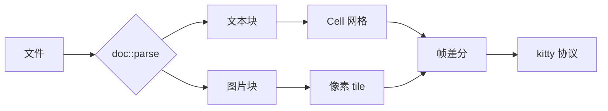
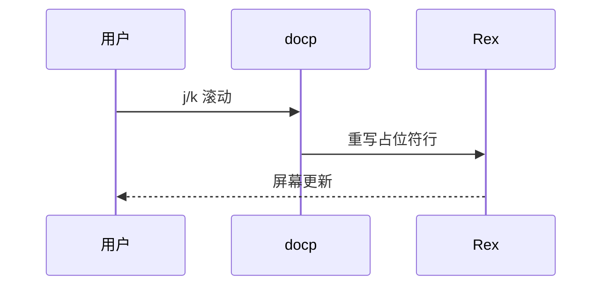

# docp 渲染测试

这是一个**混合渲染**测试文档：正文走终端文本（可搜索、可复制），
标题、图表、图片走像素。中文排版需要按显示宽度折行，而不是按字符数，
所以这一行故意写得很长很长很长很长很长很长很长很长很长很长很长很长很长很长。

## 代码高亮

```rust
use std::collections::HashMap;

/// 计算内容哈希，用于块级 diff
fn hash_block(src: &str) -> u64 {
    let mut h = xxhash_rust::xxh3::Xxh3::new();
    h.update(src.as_bytes());
    h.digest()
}

struct Engine {
    cache: HashMap<u64, Vec<u8>>,
    graphics: bool,
}
```

```python
def render(page, zoom=1.0):
    tile = page.render(clip=(0, 0, 800, 280), zoom=zoom)
    return encode_png(tile)
```

```go
func main() {
	fmt.Println("hello", runtime.NumCPU())
}
```

## 表格与任务

| 格式 | 引擎 | 可搜索 | 备注 |
|---|---|---|---|
| Markdown | pulldown-cmark | ✅ | 正文走文本 |
| PDF | mupdf | ⏳ | M2 视口分块 |
| 图片 | image + resvg | ❌ | 像素直出 |

- [x] M0 图片查看器
- [x] M1 markdown 混合渲染
- [ ] M2 PDF
- [ ] M3 文本层

## 引用块

> 普通引用：内容仍然可以复制出来。
> 第二行。

> [!NOTE]
> 这是一个 callout（GFM alert），带标题和颜色。

> [!WARNING]
> 警告样式。

## Mermaid





## 内联样式

**粗体**、*斜体*、~~删除线~~、`行内代码`、[链接](https://sw.kovidgoyal.net/kitty/graphics-protocol/)。

---

嵌套列表：

1. 第一层
   - 第二层
     - 第三层
2. 回到第一层

最后一段：验证滚动、锚定与 follow。
